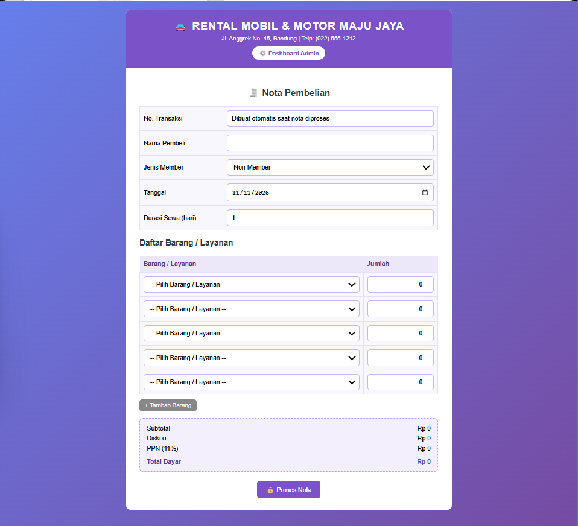
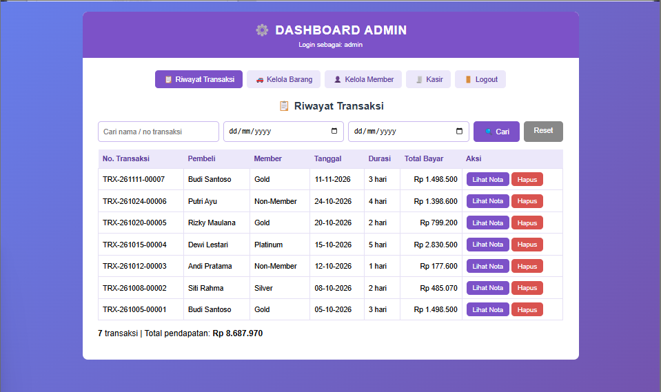
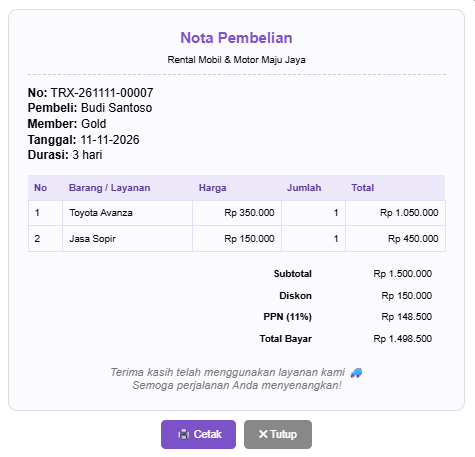
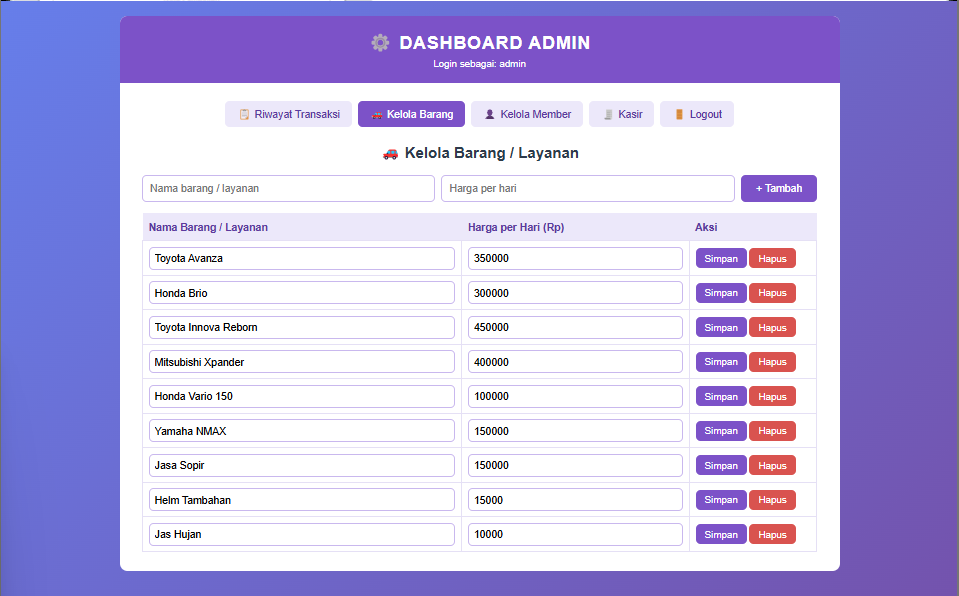
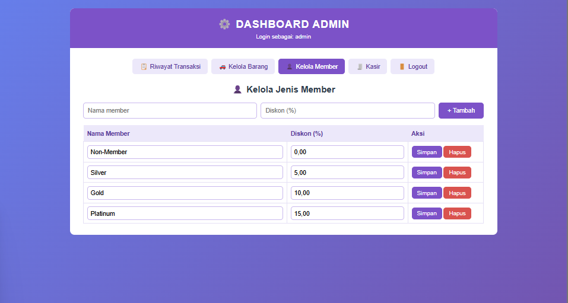

# 🚘 Rental Mobil & Motor Maju Jaya — Sistem Kasir Rental

Aplikasi kasir dan dashboard admin untuk usaha rental kendaraan, dibangun dengan **PHP (mysqli) dan MySQL/MariaDB**. Mendukung pembuatan nota (subtotal, diskon member, dan PPN 11%), riwayat transaksi dengan pencarian dan filter tanggal, serta pengelolaan barang/layanan dan jenis member.

Berawal dari tugas UTS, lalu diperbaiki: nomor transaksi dibuat di server, semua angka dihitung ulang di server, ada proteksi CSRF, validasi input, dan transaksi database. Rincian perubahannya ada di bagian [Perbaikan dari versi tugas](#-perbaikan-dari-versi-tugas).








---

## ✨ Fitur

**Kasir** (`index.php`)
- Form nota: nama pembeli, jenis member, tanggal, lama sewa, dan daftar barang/layanan (baris bisa ditambah)
- Total otomatis di layar selagi mengisi (subtotal, diskon, PPN, total bayar)
- Nota tampil sebagai pop-up setelah diproses, siap dicetak
- Nomor transaksi dibuat otomatis, format `TRX-yymmdd-NNNNN`

**Dashboard Admin** (`admin.php`, wajib login)
- **Riwayat transaksi**: pencarian nama/nomor, filter rentang tanggal, jumlah transaksi dan total pendapatan, lihat nota, hapus transaksi
- **Kelola barang/layanan**: tambah, ubah harga per hari, hapus
- **Kelola member**: tambah, ubah diskon (%), hapus

### Rumus nota
```
subtotal    = Σ (harga × jumlah × lama sewa)
diskon      = subtotal × diskon member (%)
PPN (11%)   = (subtotal − diskon) × 11%
total bayar = subtotal − diskon + PPN
```

---

## 🛠️ Teknologi & Kebutuhan

| Komponen | Keterangan |
|---|---|
| Backend | PHP **8.1+** (diuji pada 8.3; disarankan versi yang sudah ter-patch, lihat catatan) |
| Ekstensi PHP | `mysqli`, `mbstring` |
| Database | MySQL 5.7+ / 8.x atau MariaDB 10.4+ |
| Web server | Apache 2.4 dengan `AllowOverride All` (bawaan Laragon & XAMPP) |
| Frontend | HTML, CSS, dan JavaScript murni (tanpa dependensi) |

> **Catatan keamanan runtime:** pada Oktober 2026 PHP merilis perbaikan untuk celah kritis eksekusi kode jarak jauh. Gunakan PHP minimal **8.3.36 / 8.4.27 / 8.5.12** (atau lebih baru), dan jangan jalankan aplikasi di PHP 8.1 ke bawah pada server yang bisa diakses publik.

---

## 🚀 Instalasi Lokal (Laragon atau XAMPP)

### 1. Taruh project di folder web server

| Server | Lokasi |
|---|---|
| Laragon | `C:\laragon\www\rental-maju-jaya\` |
| XAMPP | `C:\xampp\htdocs\rental-maju-jaya\` |

### 2. Buat file konfigurasi
```bash
copy config.example.php config.php      # Windows (CMD)
cp config.example.php config.php        # Linux / macOS
```
Bawaan Laragon dan XAMPP (`root` tanpa password) sudah sesuai. `config.php` **tidak ikut di-commit** (ada di `.gitignore`).

### 3. Import database
Nyalakan Apache dan MySQL, lalu import **`database/schema.sql`** (otomatis membuat database `rental_majujaya`, tabel, dan data demo):
- **HeidiSQL / phpMyAdmin** → Import → pilih `database/schema.sql`, atau
- Command line: `mysql -u root < database/schema.sql`

> ⚠️ File ini menjalankan `DROP TABLE` pada tabelnya. Jika sudah ada database `rental_majujaya` yang isinya ingin disimpan, ekspor dulu.

### 4. Buka aplikasi
```
http://localhost/rental-maju-jaya/
```
Semua tautan bersifat relatif, jadi folder project boleh bernama apa saja.

---

## 👤 Akun Demo

| Username | Password |
|---|---|
| `admin` | `Admin@12345` |

> ⚠️ Hanya untuk demo lokal. **Ganti atau hapus** sebelum aplikasi dipasang di server yang bisa diakses orang lain. Untuk membuat hash password baru:
> ```bash
> php -r "echo password_hash('PasswordBaruYangKuat', PASSWORD_BCRYPT);"
> ```
> lalu `UPDATE admin SET password = '...' WHERE username = 'admin';`

---

## 🔒 Keamanan

Yang sudah diterapkan dan diuji (HTTP sungguhan terhadap PHP dan MariaDB):

- **Query**: seluruhnya memakai *prepared statement*.
- **Integritas nota**: browser hanya mengirim *apa yang disewa* (id barang dan jumlah), nama pembeli, member, tanggal, dan durasi. **Harga, subtotal, diskon, PPN, total, dan nomor transaksi dihitung/diambil dari server**; nilai palsu dari browser diabaikan.
- **Penyimpanan atomik**: nota dan item disimpan dalam satu transaksi database, sehingga tersimpan utuh atau tidak sama sekali.
- **Nomor transaksi** dibuat dari ID baris database: unik, tanpa angka acak dan tanpa perulangan (versi tugas bisa *hang* setelah 900 transaksi).
- **CSRF**: token di semua form (kasir, login, dan seluruh aksi admin).
- **Login**: `password_verify` (bcrypt), ID sesi diganti setelah login (anti *session fixation*), cookie `HttpOnly` + `SameSite=Lax`, cookie dihapus saat logout, dan maksimal 5 percobaan gagal per alamat IP dalam 15 menit.
- **Validasi input** di server: tanggal, durasi (1–365 hari), jumlah (0–100), harga, diskon (0–100, maks. 2 desimal), panjang teks, dan bentuk data (input yang dimanipulasi menjadi array tidak menyebabkan error fatal).
- **Output** di-escape (`htmlspecialchars`), termasuk nama pembeli dan nama barang.
- **Pencarian**: tanda `%` dan `_` dicari apa adanya, bukan sebagai *wildcard*.
- **Konfigurasi & rahasia**: kredensial hanya di `config.php` (di-gitignore); pesan error teknis dicatat ke log server, bukan ditampilkan; `.htaccess` memblokir akses langsung ke file pendukung dan `.sql`.

Keterbatasan yang perlu diketahui:

- **Halaman kasir terbuka tanpa login** (sesuai tugas aslinya). Untuk dipakai sungguhan, tambahkan login kasir atau batasi akses lewat jaringan.
- Belum ada paksaan HTTPS; di produksi **wajib** dipasang di belakang HTTPS.
- Pembatasan login berbasis IP, belum ada 2FA maupun log audit.
- Riwayat menampilkan 200 transaksi terbaru sekaligus (jumlah dan total pendapatan tetap dihitung dari semua data yang cocok).
- Belum ada *automated test* di repositori ini.

---

## 🔧 Perbaikan dari versi tugas

| Masalah di versi tugas | Perbaikan |
|---|---|
| Nomor transaksi dibuat dengan `rand(100,999)` dalam perulangan (hanya 900 kemungkinan, lalu *hang*) dan dikirim dari form yang bisa diubah | Dibuat di server dari ID database |
| Tidak ada CSRF di form mana pun | Token di semua form |
| Tidak ada validasi: barang/member yang tidak ada, tanggal, durasi, jumlah, harga, diskon | Validasi lengkap di server |
| Nota dan item disimpan tanpa transaksi database | Satu transaksi (*commit* / *rollback*) |
| Sesi tidak diperbarui saat login, tanpa batas percobaan | `session_regenerate_id`, pembatas login |
| Parameter `hal` dan `aksi` tidak dibatasi | Daftar putih (*whitelist*) |
| Kredensial database tertulis di kode | `config.php` yang di-gitignore |
| Tidak ada skema database | `database/schema.sql` dengan data demo |

---

## 📁 Struktur Folder

```
rental-maju-jaya/
├── index.php              # Kasir (publik)
├── login.php · logout.php
├── admin.php              # Dashboard admin
├── koneksi.php            # Konfigurasi, sesi aman, koneksi database
├── fungsi.php             # Validasi, CSRF, rumus nota, proses kasir, tampilan nota
├── style.css
├── config.example.php     # Template konfigurasi (salin ke config.php)
├── database/schema.sql    # Skema + data demo
├── docs/screenshots/
└── .htaccess
```

---

## 🌐 Deploy ke Server (Checklist)

- [ ] PHP sudah ter-patch (lihat catatan di atas), cek lewat `php -v` atau `phpinfo()` di hosting
- [ ] Pasang **HTTPS**
- [ ] Buat user database khusus (bukan `root`) dengan hak `SELECT, INSERT, UPDATE, DELETE`, lalu isi `config.php`
- [ ] `APP_DEBUG` bernilai `false`
- [ ] Ganti / hapus akun demo dan buat password yang kuat
- [ ] Pastikan `.htaccess` aktif (`AllowOverride All`); coba buka `/config.php` dan `/database/schema.sql` di browser, keduanya harus ditolak (403)
- [ ] Batasi akses halaman kasir sesuai kebutuhan
- [ ] Backup database secara berkala

---

© 2026 Titan Faranzano. Source code ditampilkan untuk dilihat dan dipelajari; penggunaan ulang tidak diizinkan tanpa izin tertulis.
